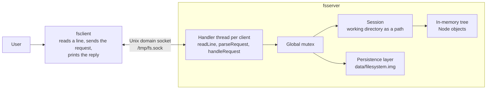

# Persistent In-Memory File System with a Custom Shell

A small file system that lives in RAM, survives restarts, and serves several
clients at the same time. It is written in C++17 for Linux and consists of two
programs that talk over a Unix domain socket:

- **`fsserver`** owns the virtual file-system tree, handles requests, keeps a
  working directory for each client, synchronizes concurrent operations, and
  saves and restores the file-system image.
- **`fsclient`** is a custom shell. It reads a command, sends it to the server,
  and prints the reply. It contains no file-system logic.

The shell is "custom" because it is a purpose-built command interface for this
virtual file system, not a general shell. It understands a fixed set of file
commands and has no pipes, redirection, globbing, quoting, variables or
scripting. It is not a replacement for Bash, and it never touches the real file
system. The real file system is used only for the socket, the persistence image,
a lock file and the build output.

## Key Features

- In-memory directory tree of files and directories with timestamps
- Commands: `pwd`, `ls`, `ls -l`, `cd`, `mkdir`, `touch`, `rm`, `rm -rf`
- Client-server communication over a Unix domain socket with a custom,
  length-framed text protocol
- Raw POSIX system calls for all socket and file I/O (no `fstream`, `fopen` or
  `std::filesystem`)
- Automatic save after every change and restore on startup, using a custom binary
  format
- Concurrent clients, one thread each, with a separate working directory per
  client
- A global mutex protecting the shared tree, and a lock file preventing two
  servers from running at once
- Specific error codes for every failure case
- Test programs for each layer and a concurrency stress test
- Makefile build with automatic header-dependency tracking

## Architecture



| Component | Responsibility |
|---|---|
| `fsclient` | Prompt, line input, translating `rm -rf` into the wire command, reading framed replies, display |
| Handler thread | Reads request lines from one client, dispatches them, writes replies |
| Session | Holds one client's working directory |
| Tree | Nodes for files and directories, path resolution, all file-system operations |
| Persistence | Serializes the tree to disk and rebuilds it on startup |

## Technology Stack

| Area | Details |
|---|---|
| Language | C++17, standard library only |
| Platform | Linux (developed on Ubuntu) |
| Compiler | `g++` with `-std=c++17 -Wall -Wextra -pthread` |
| IPC | Unix domain sockets (`AF_UNIX`, `SOCK_STREAM`) |
| Concurrency | `std::thread`, `std::mutex`, `std::lock_guard` |
| Persistence | Custom binary image written with POSIX `open`, `read`, `write`, `close` |
| Build | GNU Make with `-MMD -MP` dependency files |

## Project Structure

```
.
├── Makefile
├── README.md
├── include/
│   ├── node.h             tree node
│   ├── filesystem.h       file-system operations and result types
│   ├── protocol.h         request parsing, response building, line framing
│   ├── session.h          per-client session
│   ├── persistence.h      save and load
│   └── server.h           request handler and client thread entry point
├── src/
│   ├── filesystem.cpp
│   ├── protocol.cpp       shared by server and client
│   ├── session.cpp
│   ├── persistence.cpp
│   └── server.cpp         handleRequest, clientHandler
├── server/main.cpp        server entry point
├── client/main.cpp        shell
├── tests/                 node_test, session_test, protocol_test,
│                          persistence_test, race_test
├── data/                  filesystem.img, fsserver.lock (created at runtime)
└── build/                 object files and test binaries (generated)
```

## Prerequisites and Installation

Requires Linux, `g++` with C++17 support, and `make`. `strace`, `gdb`, `lsof`,
`ss` and `nc` are optional and only useful for inspecting the running system.

```bash
git clone <repository-url>
cd <repository-directory>
make
mkdir -p data
```

`make` produces `./fsserver` and `./fsclient` in the project root. The server
stores its files in `data/`, so the directory must exist before the first run.

| Target | Effect |
|---|---|
| `make` | Build `fsserver` and `fsclient` |
| `make tests` | Build the test programs into `build/tests/` |
| `make clean` | Remove `build/` and both binaries |

## Running the Application

Start the server from the project root, because the data path is relative:

```bash
./fsserver
```

In one or more other terminals, start clients:

```bash
./fsclient
```

- Socket: `/tmp/fs.sock`
- Persistence image: `data/filesystem.img`
- Lock file: `data/fsserver.lock`
- Stop the server with `Ctrl+C`. Changes are saved automatically after each
  operation, so there is no separate save step.
- Leave a client with `exit`, `quit` or `Ctrl+D`.

## Supported Commands

| Command | Syntax | Behavior |
|---|---|---|
| `pwd` | `pwd` | Print this client's working directory |
| `ls` | `ls` | List the working directory; directories end in `/` |
| `ls -l` | `ls -l` | One line per entry: type marker, size, name. Size is bytes for a file and the number of entries for a directory. Timestamps are not displayed |
| `cd` | `cd <path>` | Change this client's working directory. Prints the new path |
| `mkdir` | `mkdir <path>` | Create a directory |
| `touch` | `touch <path>` | Create an empty file, or update the modification time of an existing file |
| `rm` | `rm <path>` | Remove a file or an empty directory |
| `rm -rf` | `rm -rf <path>` | Remove a file, or a directory and everything under it |

Restrictions:

- Paths can be absolute or relative and may contain `.` and `..`. Repeated and
  trailing slashes and surrounding spaces are ignored.
- `mkdir`, `touch`, `rm` and `rm -rf` reject `/`, `.` and `..` as the target.
- Command names are case-insensitive; paths are case-sensitive.
- Everything after the command name is one argument, so `mkdir my folder` creates
  a directory named `my folder`. There is no quoting.
- `ls` takes no path and accepts only `-l`. `rm` accepts `-rf` only, not `-r` or
  `-f` separately. Each command takes a single path.

## Example Session

The reply formats below come from real runs; the exact listings depend on the
saved state.

```
$ ./fsclient
/ $ mkdir projects
directory created
/ $ cd projects
/projects
/projects $ touch notes.txt
file created
/projects $ ls
notes.txt
/projects $ ls -l
- 0	notes.txt
/projects $ cd ..
/
/ $ rm projects
Error [NOT_EMPTY]: rm: projects
/ $ rm -rf projects
file removed
/ $ cd /nowhere
Error [NOT_FOUND]: cd: /nowhere
/ $ exit
```

With two clients connected, a `cd` in one does not change the prompt or the
working directory of the other. After stopping and restarting `./fsserver`, the
tree from the previous run is loaded again.

## Internal Design and Data Flow

### Request lifecycle

For `mkdir projects`:

1. `fsclient` sends `MKDIR projects\n` and does not check anything itself.
2. The client's handler thread on the server reads the line with `readLine`.
3. `parseRequest` splits it into a command and an argument.
4. `handleRequest` takes the global lock, resolves the client's working
   directory, and dispatches on the command to the matching file-system function.
5. For a successful change, the server saves the image, then builds the reply
   with `buildResponse`.
6. `sendAll` writes the reply, and the client prints it.

### Wire protocol

A request is one line ending in `\n`. The command word is split from the rest on
the first space only.

```
MKDIR /home/user/newdir
LS -l
RMRF projects
```

The client rewrites the shell syntax `rm -rf <path>` to the wire command
`RMRF <path>`. A separate command word means a mistyped flag cannot cause a
recursive delete.

A response carries the byte length of its body, so output containing newlines is
unambiguous:

```
OK <len>\n<len bytes>
ERR <CODE> <len>\n<len bytes>
```

A stream socket has no message boundaries, so both sides keep a per-connection
buffer for bytes that arrive after a newline, and loop over `recv()` and
`send()` to handle partial reads and writes. A request line is limited to about
4 KB; a client that exceeds it without sending a newline is disconnected.

### In-memory tree

Each `Node` holds a name, a directory flag, a non-owning parent pointer, a vector
of children owned through `std::unique_ptr`, file content, and creation and
modification times. One struct with a flag is used instead of separate file and
directory types, which keeps both the code and the serialization simple. Because
a parent owns its children, removing a node destroys its whole subtree
automatically, which is why `rm -rf` needs no recursive cleanup code. `rm` adds a
policy check (refuse non-empty directories) on top of the same removal.

### Path resolution

`resolvePath` takes a starting directory, the root and a path. It splits the path
on `/`, starts at the root for absolute paths, and walks one segment at a time.
`.` stays put, `..` moves to the parent (the parent of the root is the root), and
any other name is looked up among the current node's children. Walking into a
file with path remaining returns `NOT_A_DIRECTORY`. Commands that create or
remove something split the path into a parent path and a final name, resolve the
parent, and operate on the name.

### Error reporting

File-system functions return result codes instead of printing. The server maps
them to protocol codes: `NOT_FOUND`, `EXISTS`, `NOT_A_DIRECTORY`, `NOT_EMPTY`,
`INVALID_PATH`, plus `UNKNOWN_COMMAND` and `BAD_REQUEST` for malformed input. The
client prints `Error [CODE]: message`.

## System Calls and Operating-System Concepts

Application-level calls, and the names they carry in `strace` output:

| Call in source | Seen in `strace` as | Role |
|---|---|---|
| `socket` | `socket` | Create the `AF_UNIX`, `SOCK_STREAM` endpoint (server and client) |
| `unlink` | `unlink` | Remove a stale socket file before binding |
| `bind` | `bind` | Attach the server socket to `/tmp/fs.sock` |
| `listen` | `listen` | Mark the socket as accepting connections |
| `accept` | `accept` | Return a new descriptor for each client |
| `connect` | `connect` | Client connects to the server |
| `recv` | `recvfrom` | Read request and reply bytes |
| `send` | `sendto` | Write request and reply bytes |
| `open` | `openat` | Open the image and the lock file |
| `read`, `write` | `read`, `write` | Load and save the image |
| `flock` | `flock` | Exclusive lock so only one server runs |
| `close` | `close` | Release descriptors |

Runtime-level mechanisms:

| Mechanism | Underlying operation |
|---|---|
| `std::thread` | `pthread_create`, which issues `clone3` (observed in `strace`) |
| `std::mutex`, `std::lock_guard` | POSIX mutex; blocked threads wait in the kernel, typically through `futex` (not observed in the trace) |

Unix domain sockets suit this design because both programs run on the same
machine. They skip the network stack, give reliable ordered byte streams like
TCP, and are addressed by a file path whose permissions control access.

Each accepted connection is a file descriptor. The listening socket stays on its
own descriptor, and every `accept` returns a new one, so a single listener can
serve many clients.

## Persistence and Recovery

**When it saves.** After every successful `mkdir`, `touch`, `rm` and `rm -rf`,
inside the same lock as the operation. Read-only commands do not save.

**Format.** The tree is written in pre-order to `data/filesystem.img`. Each node
is stored as:

```
1 byte   directory flag
4 bytes  name length, then the name
8 bytes  creation time
8 bytes  modification time
4 bytes  content length, then the content
4 bytes  child count, then each child in the same format
```

The file is opened with `O_WRONLY`, `O_CREAT` and `O_TRUNC` (mode `0644`) and
rewritten completely each time. Each field is written with its own `write()`.

**On startup.** Before accepting clients, the server tries to load the image and
distinguishes three cases:

- No file (first run): start with an empty root directory.
- Valid file: rebuild the tree. Loaded nodes are new objects with new addresses.
- Corrupted or truncated file: log a warning and start with an empty tree. The
  bad file is replaced by the next successful save.

**If a save fails**, the server logs a warning on its standard error.

**Crash consistency.** Saving is neither atomic nor transactional. The image is
truncated and rewritten in place, and no `fsync()` is called. A crash or power
loss during a save can leave a truncated file, which the next startup treats as
corrupted and therefore starts empty. The numeric fields use the machine's native
byte order and the file has no version field, so the format is not portable
across architectures or safe against future format changes.

## Concurrency and Session Management

**Threading model.** The main thread only calls `accept()`. Each connection gets
a detached `std::thread` running `clientHandler`, which loops on `readLine`,
`handleRequest` and `sendAll` until the client disconnects. There is no thread
pool and no limit on the number of clients.

**Locking.** One global `std::mutex`, held through `std::lock_guard`, covers each
whole `handleRequest` call: session lookup, path resolution, the operation, and
the save. Reads are locked as well, because reading a `std::vector` while another
thread modifies it is undefined behavior. Socket reads and writes happen outside
the lock. Without the lock, two clients creating the same name could both pass
the existence check and both insert it.

**Sessions.** Each handler thread owns a `ClientSession` on its own stack, so
there is no shared session table. The session stores the working directory as an
absolute path string, not a node pointer, and re-resolves it on every request.
If another client deletes that directory, resolution fails, the session resets to
`/`, and the reply says so. A stored pointer would have been left dangling. The
session is discarded when the client disconnects.

**Trade-off.** One global lock is easy to reason about but serializes all
operations, even in unrelated directories, and the disk write happens while the
lock is held, so a slow save delays every client. The stress test below checks
the main cases; it does not prove the absence of all races.

## Testing

The tests are print-based programs, not an assertion framework, and there is no
single command that runs them all. Build them with `make tests`; each binary is
in `build/tests/`.

| Program | Verifies | Needs a running server |
|---|---|---|
| `node_test` | Tree construction, `pwd`, `ls`, `mkdir`, `touch`, `cd`, `rm`, `rm -rf`, `ls -l`, path resolution and the path-based wrappers | No |
| `session_test` | Independent working directories, and a session reset after another client deletes its directory | No |
| `protocol_test` | Request parsing and response framing | No |
| `persistence_test` | Save, discard the tree, reload, and compare the structure | No |
| `race_test` | 20 simultaneous `mkdir` of the same name (expect one `OK`, the rest `EXISTS`); `rm -rf` racing `ls` (expect the server to stay alive) | Yes |

```bash
make tests
./build/tests/node_test
./build/tests/session_test
./build/tests/protocol_test
./build/tests/persistence_test      # writes test_fs.img in the current directory
```

`race_test` changes the live file system and expects to start from a clean
state, so run it against a fresh image:

```bash
rm -f data/filesystem.img
./fsserver &
./build/tests/race_test
kill %1
```

The system can also be inspected from outside:

```bash
strace -f -o /tmp/fsserver.trace ./fsserver
ps -o pid,nlwp,cmd -p $(pgrep fsserver)     # threads: main plus one per client
lsof -p $(pgrep fsserver)                   # open descriptors
ss -xlp | grep fs.sock                      # listening socket and connections
```

## Limitations and Future Improvements

### Current limitations

- **Global lock.** All operations are serialized, including the save to disk.
- **Persistence is not crash-atomic.** See Persistence and Recovery. The save
  rewrites the whole tree with many small `write()` calls and no `fsync()`.
- **Image format.** No version field, native byte order, and a corrupted image is
  not backed up before it is replaced.
- **No file content commands.** Content is stored and saved, but nothing can
  write or read it, so file sizes are always 0.
- **Listing detail.** `ls -l` shows no timestamps, permissions or owner.
- **No permissions or ownership.**
- **Directory identity.** Sessions store paths, so a directory deleted and
  recreated at the same path looks unchanged to other clients. A real file
  system tracks identity with inodes.
- **Shutdown.** The server stops on a signal. Every change is already saved, but
  clients are not drained.
- **One thread per client** with no upper bound.
- **Tests** print results for inspection and do not assert; the concurrency test
  is timing-dependent and has not been run under a race detector.

### Proposed improvements

- Write the image to a temporary file, `fsync()` it, then `rename()` it over the
  real file, building the contents in one buffer first.
- Add a magic number and version field to the image and fix its byte order.
- Add commands to write and read file contents.
- Replace the global mutex with a reader-writer lock, then with finer-grained
  locks.
- Give nodes stable identifiers so sessions survive delete and recreate
  correctly.
- Convert the tests to assertions and add a `make check` target.
- Handle `SIGINT` and `SIGTERM` for a graceful shutdown.

## Future Roadmap

1. Crash-safe persistence (temporary file, `fsync()`, atomic `rename()`).
2. File-content commands, with a versioned image format.
3. Assertion-based tests and a `make check` target.
4. A reader-writer lock, then finer-grained locking.
5. Graceful shutdown.

## Learning Outcomes

- Using the socket API (`socket`, `bind`, `listen`, `accept`, `connect`) and
  seeing how the kernel exposes each call with `strace`
- Designing a framed protocol on a byte stream, including partial reads and
  writes
- Process and thread concepts: shared address space, per-thread stacks, and the
  need for mutual exclusion on shared data
- Recognizing check-then-act races and testing them with real concurrent clients
- Ownership-based memory management with `unique_ptr`, and avoiding dangling
  pointers across clients
- Persistence by serialization: designing a binary format, validating input,
  and reasoning about crash consistency
- Build tooling: compile versus link stages, incremental builds, and header
  dependency tracking
- Debugging running programs with `strace`, `gdb`, `lsof` and `ss`